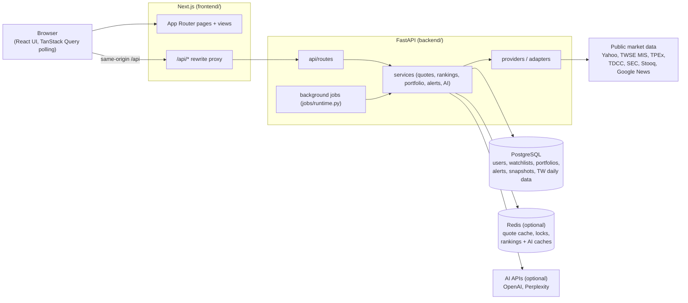

# Architecture overview

How the app is put together today. Product intent: [product-scope.md](product-scope.md). Backend module map: [backend-architecture.md](backend-architecture.md).

## System at a glance



The browser only talks to the Next.js origin. Next.js rewrites `/api/*` to FastAPI (`BACKEND_PROXY_URL`, default `http://127.0.0.1:8000`; see `frontend/next.config.mjs`), so there is no CORS in the normal setup.

## Runtime components

| Component | Role | Where |
| --- | --- | --- |
| Next.js 16 / React 18 | UI, routing, `/api` proxy. Carbon Design System components, TanStack Query for fetching and polling. Charts are hand-built SVG from a backend-computed layout. | `frontend/` |
| FastAPI | REST API under `/api`, one WebSocket (`/api/stream`), `/health`. Starlette session cookie for auth. | `backend/app/main.py` |
| Background jobs | Quote refresher, portfolio history sampler, alert evaluator, rankings snapshot sampler, Taiwan market-data refresh, optional rankings EOD archive. Local/dev: threads inside the API process (`RUN_BACKGROUND_JOBS=true`). k8s: API pods set `RUN_BACKGROUND_JOBS=false`; `stock-ticker-backend-worker` runs `python -m app.worker` (#276). | `backend/app/jobs/runtime.py`, `backend/app/worker.py` |
| PostgreSQL | System of record: users, watchlists, portfolio positions/assets/history, realized trades, alerts/events, AI preferences/keys, ranking snapshots, Taiwan institutional and margin-short daily history. Alembic migrations. | `backend/app/db/`, `backend/alembic/` |
| Redis (optional) | Quote cache with stale-while-revalidate, refresh and leader locks, rankings and Taiwan-signal caches, stock-AI narrative cache. Without Redis, quote caching falls back to per-process memory. | `services/quote_redis_cache.py` and other `*_cache.py` |
| Shared contracts | TypeScript API types imported by the frontend as `@shared/*`. Backend Pydantic schemas are the server-side source; the two are kept in sync by hand. | `packages/shared-contracts/` |

## Directory responsibilities

```text
backend/app/api/routes/     HTTP handlers; thin, call services
backend/app/services/       business logic, caching, market clock, background samplers
backend/app/services/providers/   US (Yahoo/SEC) and TW (MIS/TWSE/TPEx/Yahoo) adapters, shared Yahoo quote math
backend/app/repositories/   SQLAlchemy persistence, always scoped by user_id for user data
backend/app/db/ + alembic/  models and migrations
backend/tests/              unit, integration (Postgres), k3s smoke
frontend/src/app/           Next.js routes (/, /stock/[stockId], /portfolio, /rankings, /alerts, ...)
frontend/src/views/         page-level components and page state
frontend/src/components/    reusable UI (stock card, chart, quote summary, ...)
frontend/src/services/      API client, formatting, market-data helpers
frontend/tests/             Playwright E2E and extra Vitest suites
k8s/                        kustomize manifests for k3d/k3s
infra/                      optional Terraform (Azure SQL archive, AWS heartbeat)
scripts/                    deploy, backup/restore, CI smoke helpers
```

## Request and data flow

1. **Page load:** the browser loads a Next.js page, which fetches `/api/...` through the rewrite.
2. **Routes → services:** handlers resolve the user (`get_effective_user_id` for user-owned routes; see [multi-user-design.md](multi-user-design.md)) and call a service.
3. **User data** is read and written in Postgres through repositories filtered by `user_id`.
4. **Market data** goes through `QuoteService` and the ranking and history services. These serve from cache when possible; otherwise they call a provider adapter. When the background quote refresher is running, watchlist and quote reads are cache-first and never block on upstream. Details: [quote-refresh-design.md](quote-refresh-design.md).
5. **Polling:** the UI refreshes with TanStack Query intervals (for example ~45 s for watchlist quotes while a market is open). It does not use the `/api/stream` WebSocket today.
6. **Background jobs** warm the quote cache for every user's watchlist and portfolio symbols, sample portfolio value, evaluate alert rules, and capture ranking snapshots, independently of requests.

## Deployment modes

| Mode | How | Notes |
| --- | --- | --- |
| Local dev | `uvicorn app.main:app` + `npm run dev`, local Postgres, optional Redis via `backend/docker-compose.redis.yml` | `AUTH_ENABLED=false` by default: single-user `default-user`. [local-development.md](local-development.md) |
| k3d / k3s | `./scripts/deploy-k3s.sh k3d` (macOS) or `k3s` (Ubuntu): build images, import into the cluster, `kubectl apply -k k8s` | Namespace with Postgres, Redis, backend API (jobs off), backend worker (jobs on), frontend, NodePort `:30080`, history-capture CronJob. Ships with `AUTH_ENABLED=true`. [kubernetes.md](kubernetes.md) |
| GHCR images | `publish-ghcr.yml` builds and pushes backend/frontend images after green `Test And Smoke` on `main` or tags | Optional pull path for k3s. |
| Optional add-ons | Prometheus/Grafana overlay, Azure SQL EOD rankings archive, AWS outbound heartbeat | [observability.md](observability.md), [azure-rankings-archive.md](azure-rankings-archive.md), [aws-health-monitor.md](aws-health-monitor.md) |

## Architectural tradeoffs

- **Modular monolith with optional worker split (#276).** Locally, one FastAPI process can hold the API and every background job. In k8s, API replicas set `RUN_BACKGROUND_JOBS=false` and a separate worker Deployment runs the same image via `python -m app.worker`. Redis leader locks (`job_leader_lock.py`) are held for the job's poll interval and are released early only when the tick fails, so a second worker does not repeat that interval's provider work. Taiwan's daily refresh also stores the local date in Redis (or process memory when Redis is unset) so a later worker does not fetch the same day again. API pods publish immediate quote-refresh ids into a Redis set; only the replica that holds the current quote-cycle lock drains it. The worker `/health` probe returns 503 when an enabled job's thread has died or its last success is older than that job's staleness budget.
- **Free public data sources.** No paid market-data feed. Upstreams are rate-limited, sometimes delayed, and change format without notice. The backend absorbs this with caching, circuit breakers, fallbacks, and explicit `stale` / `unavailable` states instead of guessing values.
- **Server-side computation.** Change %, SMA overlays, chart layout, key price levels, and Taiwan limit status are computed in the backend, so the UI renders numbers rather than deriving them.
- **Optional Redis.** Everything works without Redis using per-process memory caches. With more than one backend replica, Redis is effectively required for shared caching and refresher leadership.
- **Same-origin proxy.** The Next.js rewrite keeps cookies first-party and avoids CORS, at the cost of every API call passing through the Next.js server.

## Current limitations

- `/api/stream` (cache-first quote push every 3 s) is implemented but unused by the frontend.
- TypeScript contracts and Pydantic schemas are maintained in parallel; nothing checks that they agree.
- The k8s manifests still target a single node (one API replica, one worker, in-cluster Postgres with a PVC). They are not a high-availability setup.
